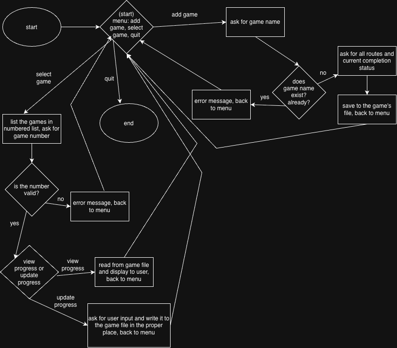

# otome-tracker

Adds and tracks otome games.

## The Problem

Right now I track my otome game completion, but I wasn't able to get a good sense of what I had completed. I'd like to have a designated, organized space where I can clearly see my progress for each game.

## How It Works

This program can add or select otome games. If the user chooses to add an otome game, the program will ask for the name, the names of the routes, and the current completion status and add all of that to a file. If the user chooses to select an otome game, they will have the option of either viewing the current progress for that game or updating the current progress of that game. There is a quit option that will end the program. 

## Tech Stack

- **Language:** Java
- **Libraries:** java.util.Scanner, java.io
- **External tools:** N/A

## Setup

1. Install JDK 25.
2. Download and extract this repository.
3. Open terminal and cd into the otome-tracker folder.
4. Compile the program using this: `javac src/OtomeTracker.java`
5. Run the program using this: `java -cp src OtomeTracker`

## Usage

The menu has three options: Add game, select game, and quit. Type the corresponding number and press Enter to choose which action you want to take.
- Add game: Enter the otome game name, number of routes/love interests, love interest names, and completion status when prompted. Ex: "Collar x Malice", 5, "Yanagi Aiji", "Okazaki Kei", "Shiraishi Kageyuki", "Mineo Enomoto", "Takeru Sasazuka", "Completed". Do not enter the names in one go, enter one name, press the enter key, and then enter the next. Quotations are not part of the input.
- Select game: Select a game from the ones you have inputted by typing in the corresponding number. Choose to either view or change the completion status of this game by typing in the corresponding number. Ex: 1 (corresponds to Collar x Malice), 1 (corresponds to viewing completion status).
- Quit: Quits program.

## Roadmap

- [ ] Track progress for individual routes
- [ ] Editable game notes
- [ ] Editable route notes

## Author

Anjali Gantayat, https://github.com/anjaligantayat7
