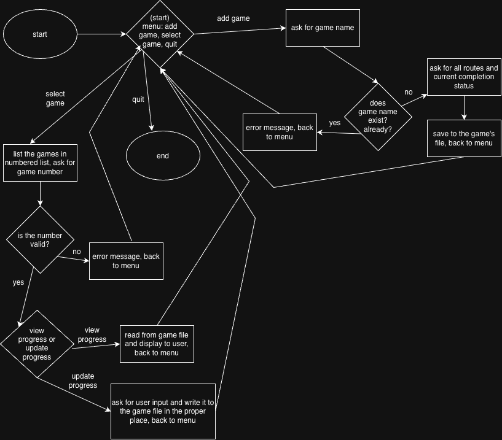

# otome-tracker

Adds and tracks otome games.

## The Problem

Right now I track my otome game completion, but I wasn't able to get a good sense of what I had completed. I'd like to have a designated, organized space where I can clearly see my progress for each game.

## How It Works

This program can add or select otome games. If the user chooses to add an otome game, the program will ask for the name, the names of the routes, and the current completion status and add all of that to a file. If the user chooses to select an otome game, they will have the option of either viewing the current progress for that game or updating the current progress of that game. There is a quit option that will end the program. 

## Tech Stack

- **Language:** Java
- **Libraries:** java.util.Scanner, java.io
- **External tools:** N/A

## Setup

Step-by-step: how does someone who just cloned your repo get it
running? -> Pending for now

## Usage

How to actually run the thing, with examples. -> Pending for now

## Roadmap

- [ ] Track progress for individual routes
- [ ] Editable game notes
- [ ] Editable route notes

## Author

Anjali Gantayat, https://github.com/anjaligantayat7
